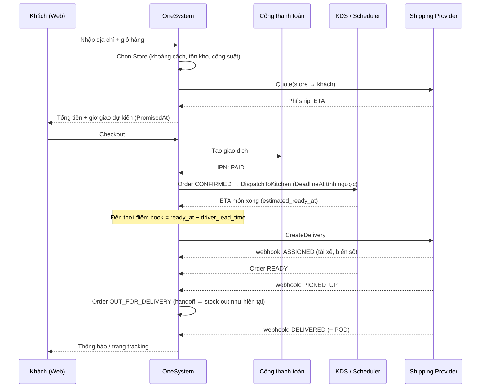

# Nghiên cứu giải pháp Shipment cho đơn đặt qua Web (Direct Delivery)

**Ngày:** 2026-10-24
**Trạng thái:** DRAFT, cần business review
**Liên quan:** `internal/domain/models/order.go`, `internal/usecase/order_usecase.go`, `internal/usecase/order_orchestrator.go`, `OneSystem Business Specification.md` §4.1–4.3

---

## 1. Bài toán

Khi khách đặt qua **GrabFood / ShopeeFood**, nền tảng lo hết phần giao hàng: tìm tài xế, tính phí ship, theo dõi, thu tiền, xử lý khiếu nại. Store chỉ cần nấu xong và đưa đồ cho tài xế. Ngược lại, khi khách đặt qua **web của mình**, chuỗi phải tự làm những việc đó:

| Việc | Grab/Shopee | Web của mình |
|---|---|---|
| Thông tin khách + địa chỉ | Nền tảng giữ | **OneSystem phải lưu** |
| Chọn Store phục vụ | Khách chọn quán | **Hệ thống chọn** (gần nhất, còn hàng, còn công suất) |
| Báo phí ship & ETA | Nền tảng tính | **Phải lấy báo giá** từ đơn vị giao hoặc tự tính theo vùng |
| Thanh toán | Nền tảng thu | **Cổng thanh toán** (VNPay/MoMo/ZaloPay) hoặc COD |
| Gọi tài xế | Tự động | **Phải book qua API** (Ahamove/Lalamove/GrabExpress…) hoặc dùng shipper nội bộ |
| Theo dõi hành trình | App nền tảng | **Webhook + trang tracking** |
| Tài xế huỷ / không tìm được tài xế | Nền tảng xử lý | **Phải tự re-book / fallback** |
| Đối soát phí ship, COD | Nền tảng | **Phải tự đối soát** |

**Lợi thế riêng của mình:** OneSystem đã có Scheduling Engine và KDS nên **biết trước lúc nào món sẽ xong**. Grab/Shopee không biết điều này, nên tài xế của họ thường phải đứng chờ ở quán. Mình có thể **gọi tài xế đúng lúc (just-in-time)** để món vừa xong thì tài xế vừa tới. Món còn nóng, đỡ tốn phí chờ, và khách hài lòng hơn.

---

## 2. Hiện trạng code (gap analysis)

| Thành phần | Hiện tại | Thiếu cho Web Delivery |
|---|---|---|
| `models.OrderSource` | `PLATFORM`, `DIRECT_POS` | Thêm `WEB` (sau này có thể thêm `APP`, `HOTLINE`) |
| `models.Order` | Không có thông tin khách, địa chỉ, hình thức nhận hàng, thanh toán | `Customer`, `Fulfillment` (DELIVERY/PICKUP), `DeliveryAddress`, `PaymentStatus`, `DeliveryFee`, `PromisedAt` |
| `OrderStatus` | `PENDING → PROCESSING → COMPLETED / CANCELLED` | Cần biết thêm các trạng thái `READY`, `OUT_FOR_DELIVERY`, `DELIVERED`, `DELIVERY_FAILED` (trình bày ở §4.3) |
| `orderUseCase.CreateOrder` | Nguồn khác `"PLATFORM"` đều bị ép thành `DIRECT_POS`; kiểm tồn kho rồi dispatch xuống bếp ngay | Đơn web **chỉ được vào bếp sau khi đã thanh toán** (với đơn prepaid) |
| `DeadlineAt` | Lấy từ deadline của nền tảng | Đơn web: `DeadlineAt = PromisedAt − thời gian di chuyển − buffer` |
| `GetProductionStatusForOrders` | Tính `READY`/`COOKING` khi đọc (field transient) | Cần một **event "order ready"** để kích hoạt book tài xế |
| Shipment / giao hàng | Chưa có. `GoodsIssue` trong supply chain có lưu tài xế Lalamove nhưng nhập tay | Cần aggregate `Shipment` riêng và lớp adapter cho các đơn vị giao |

---

## 3. Các phương án giao hàng

### 3.1 Đơn vị giao hàng nội thành có API (on-demand)

| Đơn vị | Điểm mạnh | Lưu ý |
|---|---|---|
| **Ahamove** | Đơn vị Việt Nam, mạnh ở HCM/HN, có dịch vụ siêu tốc phù hợp F&B, hỗ trợ COD. API v3 (staging `partner-apistg.ahamove.com/v3`, prod `partner-api.ahamove.com/v3`), webhook callback mỗi khi đơn đổi trạng thái, auth bằng API key / bearer / basic. | Đăng ký đối tác để nhận API key. Kiểm tra lại định dạng body (JSON hay URL-encoded) theo version đang dùng. |
| **Lalamove** | API v3 rõ ràng: Quotation → Place Order → Order Details, cấu hình webhook qua API, phân theo market (header `Market`, có VN). Chuỗi đã dùng Lalamove cho luân chuyển nội bộ (xem `example_flows/end_to_end_inhouse_supply_flow.md`). | Quotation có thời hạn, phải place order trước khi hết hạn. Stop ID của quote phải khớp khi đặt. |
| **GrabExpress** | Tài xế đông, thương hiệu quen thuộc. Có API quote/create (OAuth2 client_credentials) và webhook. | Không tìm được tài liệu chính thức công khai cho VN, chỉ có nguồn thứ ba. Cần liên hệ Grab để có partner portal. |
| Be / Xanh SM Express… | Có thể dùng làm fallback | Chưa khảo sát API |

> GHN, GHTK, Viettel Post là giao **liên tỉnh, theo ngày**, **không phù hợp** với đồ ăn nóng.

### 3.2 Shipper nội bộ (in-house)

- Phù hợp khi khu vực có mật độ đơn cao quanh Store (bán kính < 3km, giờ cao điểm đều đặn).
- Cần thêm app/màn hình cho shipper (nhận đơn, xác nhận đã lấy, đã giao, chụp ảnh POD), quản lý ca và tiền COD shipper đang cầm.
- Có thể tái dùng `Staff` / `StaffShift` hiện có, thêm role `RIDER`.

### 3.3 Khách tự đến lấy (Pickup)

- Rẻ nhất, nên luôn hỗ trợ. Không cần Shipment, chỉ cần `PickupCode` và thông báo khi `READY`.

### 3.4 Khuyến nghị

**Thiết kế đa đơn vị ngay từ đầu (adapter pattern), nhưng triển khai theo từng bước:**

1. **Phase 1:** Pickup và **một** đơn vị on-demand (đề xuất **Ahamove**: nội địa, phù hợp F&B, có COD, tài liệu API công khai). Có thêm adapter `MANUAL` cho phép store tự gọi tài xế rồi nhập tay mã vận đơn, dùng làm phương án dự phòng.
2. **Phase 2:** Thêm **Lalamove** hoặc **GrabExpress** làm fallback. Tự động chuyển sang đơn vị khác khi không tìm được tài xế sau N phút.
3. **Phase 3:** So giá (rate shopping) và/hoặc shipper nội bộ cho các store có mật độ đơn cao.

---

## 4. Thiết kế đề xuất

### 4.1 Luồng end-to-end



### 4.2 Mô hình dữ liệu

**Mở rộng `Order`** (giữ tương thích ngược, tất cả là optional):

```go
const OrderSourceWeb OrderSource = "WEB"

type FulfillmentType string // DELIVERY | PICKUP | DINE_IN

type Order struct {
    // ... field cũ ...
    Fulfillment     FulfillmentType `json:"fulfillment,omitempty"`
    Customer        *CustomerInfo   `json:"customer,omitempty"`         // name, phone (bắt buộc cho DELIVERY)
    DeliveryAddress *Address        `json:"delivery_address,omitempty"` // text, lat/lng, note
    PromisedAt      *time.Time      `json:"promised_at,omitempty"`      // giờ giao đã hứa với khách
    DeliveryFee     float64         `json:"delivery_fee,omitempty"`     // phí khách trả (có thể ≠ phí thực tế)
    Payment         *PaymentInfo    `json:"payment,omitempty"`          // method (PREPAID/COD), status, provider_txn_id
    PickupCode      string          `json:"pickup_code,omitempty"`      // mã ngắn đối chiếu khi bàn giao
    ActiveShipmentID *string        `json:"active_shipment_id,omitempty"`
}
```

**Aggregate mới `Shipment`.** Quan hệ là 1 Order : N Shipment, vì tài xế huỷ hoặc phải đổi đơn vị thì sẽ tạo shipment mới, và shipment cũ được giữ lại làm lịch sử để đối soát phí:

```go
type ShipmentStatus string
const (
    ShipmentPendingBooking  ShipmentStatus = "PENDING_BOOKING"  // đã lên lịch, chưa gọi API
    ShipmentSearchingDriver ShipmentStatus = "SEARCHING_DRIVER"
    ShipmentDriverAssigned  ShipmentStatus = "DRIVER_ASSIGNED"
    ShipmentAtPickup        ShipmentStatus = "AT_PICKUP"
    ShipmentPickedUp        ShipmentStatus = "PICKED_UP"
    ShipmentDelivered       ShipmentStatus = "DELIVERED"
    ShipmentFailed          ShipmentStatus = "FAILED"     // giao không thành công
    ShipmentCancelled       ShipmentStatus = "CANCELLED"
    ShipmentReturned        ShipmentStatus = "RETURNED"
)

type Shipment struct {
    ID               string
    OrderID          string
    NodeID           string          // Store pickup
    Provider         string          // AHAMOVE | LALAMOVE | GRAB_EXPRESS | IN_HOUSE | MANUAL
    ProviderOrderID  string          // mã vận đơn bên đơn vị giao
    ServiceType      string          // ví dụ bike / siêu tốc
    Status           ShipmentStatus
    Pickup, Dropoff  Address
    QuotedFee        float64         // lúc báo giá
    ActualFee        float64         // theo webhook / đối soát
    CODAmount        float64         // 0 nếu prepaid
    Driver           *DriverInfo     // name, phone, plate, photo
    TrackingURL      string
    ScheduledBookAt  *time.Time      // thời điểm dự kiến gọi API
    Events           []ShipmentEvent // log mọi webhook (raw payload) để audit + idempotency
    CancelReason     string
    CreatedAt, UpdatedAt time.Time
}
```

### 4.3 Trạng thái Order vs Shipment

Nên giữ **Order lifecycle** gọn và để chi tiết giao hàng trong **Shipment**:

```
Order (WEB/DELIVERY):
PENDING_PAYMENT → CONFIRMED → PROCESSING (đang nấu) → READY → OUT_FOR_DELIVERY → DELIVERED
                       ↘ CANCELLED (chưa nấu: hoàn tiền 100%)          ↘ DELIVERY_FAILED
```

- **Stock-out / hoàn tất phía Store** vẫn xảy ra lúc **bàn giao** (đúng spec §4.3 "Order is marked COMPLETED upon handoff"). Với đơn delivery, handoff là lúc `PICKED_UP`. Có thể gọi `CompleteOrder` hiện tại tại thời điểm này, sau đó Order chuyển tiếp sang `DELIVERED` theo webhook.
- Đơn POS / Platform **không đổi** hành vi.

### 4.4 Port / Adapter cho đơn vị giao hàng

Đặt interface ở `internal/domain/services`, implementation ở `internal/infrastructure/shipping/<provider>`:

```go
type ShippingProvider interface {
    Code() string
    Quote(ctx context.Context, req QuoteRequest) (*Quote, error)               // phí, ETA, quote_id, hết hạn
    CreateDelivery(ctx context.Context, req CreateDeliveryRequest) (*ProviderDelivery, error)
    CancelDelivery(ctx context.Context, providerOrderID, reason string) error
    GetDelivery(ctx context.Context, providerOrderID string) (*ProviderDelivery, error) // cho reconcile
    // Xác thực chữ ký / token và map payload của provider → trạng thái nội bộ
    ParseWebhook(r *http.Request) (*ShipmentUpdate, error)
}
```

- **Map trạng thái** của từng provider về `ShipmentStatus` ngay trong adapter, để phần nghiệp vụ không phải biết chi tiết từng hãng.
- Route webhook: `POST /api/v1/shipping/webhooks/:provider`, không dùng auth người dùng mà xác thực theo cơ chế của provider.
- Thêm `MockProvider` để test integration và chạy kịch bản stress test giống `scheduling_engine_*_test.go`.

### 4.5 Gọi tài xế đúng lúc (điểm khác biệt chính)

```
book_at = estimated_ready_at − driver_lead_time(store, provider, khung giờ)
```

- `estimated_ready_at` lấy từ Scheduling Engine (ETA hoàn thành các ProductionOrder có `RefOrderID = order.ID`).
- `driver_lead_time` là thời gian trung bình từ lúc book đến lúc tài xế tới quán. Ban đầu dùng cấu hình mặc định (ví dụ 8–10 phút), về sau **học từ dữ liệu** `Events` (thời gian `SEARCHING → AT_PICKUP` theo store/giờ).
- Một background worker giống `OrderPoolingOrchestrator.Start` sẽ quét các shipment `PENDING_BOOKING` có `ScheduledBookAt <= now` để gọi `CreateDelivery`.
- **Re-plan:** khi ETA bếp thay đổi (máy bận, đơn dồn), worker tính lại `book_at`. Nếu tài xế đã tới mà món chưa xong thì ghi nhận waiting time để tinh chỉnh.
- Option an toàn cho Phase 1: **book ngay khi order CONFIRMED** nếu thời gian nấu dự kiến < `driver_lead_time`.

### 4.6 Kết nối với KDS / Scheduler hiện có

- Đơn web có `PromisedAt`, nên tính `DeadlineAt = PromisedAt − travel_eta − buffer` và gán cho ProductionOrder. `dispatcher.go` đã dùng `DeadlineAt` để tính urgency nên **không cần sửa scheduler**.
- `order_orchestrator.go` đã flush đơn quá hạn theo `DeadlineAt`, nên đơn web cũng tự hưởng cơ chế này.
- Cần phát **event `OrderReady`** khi PO cuối cùng của order `COMPLETED`. Logic hiện đang nằm trong `GetProductionStatusForOrders` (chỉ tính lúc đọc), nên cần hook ở `ConfirmCompletion` để: (1) báo cho màn hình đóng gói, (2) báo khách nếu PICKUP, (3) cập nhật lại `book_at` nếu tài xế chưa được book.
- **Màn hình "Gom món / Handoff"** cần hiển thị: tài xế nào, biển số, ETA tới quán, `PickupCode`. Staff bấm "Đã giao cho tài xế" như một bước xác nhận dự phòng nếu webhook `PICKED_UP` bị trễ.

### 4.7 Xử lý lỗi và ngoại lệ

| Tình huống | Xử lý |
|---|---|
| Không tìm được tài xế sau N phút (cấu hình) | Huỷ shipment, tạo shipment mới với provider kế tiếp. Nếu hết provider thì cảnh báo cho Store Manager (gọi tay qua adapter `MANUAL`) |
| Tài xế huỷ sau khi nhận | Tự động re-book, giữ shipment cũ ở trạng thái `CANCELLED` |
| Webhook trùng / sai thứ tự | Idempotency theo `(provider, provider_order_id, status, timestamp)`; không cho trạng thái đi lùi |
| Mất webhook | Worker reconcile gọi `GetDelivery` cho các shipment "treo" quá X phút |
| Khách huỷ sau khi bếp đã nấu | Theo chính sách: không hoàn tiền hoặc hoàn một phần. Nếu tài xế đã nhận đơn thì có thể mất phí huỷ |
| Giao thất bại (khách không nghe máy) | `DELIVERY_FAILED`, tài xế hoàn hàng về store (`RETURNED`), ghi nhận hao hụt (waste) |
| Store hết hàng / quá tải lúc khách đang checkout | Kiểm tồn kho và công suất **trước khi** báo giờ giao; giữ chỗ tồn kho (reservation) trong thời gian chờ thanh toán (ví dụ 10 phút) |

### 4.8 Thanh toán và đối soát

- **Khuyến nghị: prepaid** (VNPay / MoMo / ZaloPay) cho đơn delivery, vì giảm rủi ro "bom hàng" và không phải đối soát tiền COD với tài xế. COD có thể bật theo store hoặc giới hạn giá trị đơn.
- Lưu riêng `DeliveryFee` (khách trả) và `Shipment.ActualFee` (chuỗi trả). Phần chênh lệch là **chi phí trợ giá ship**, hạch toán vào OpEx của Store, tương tự cách `example_flows` đã tính phí ship Lalamove vào OpEx.
- Báo cáo đối soát hàng ngày theo provider gồm tổng phí, số đơn, phí huỷ và COD đã thu so với COD đã được chuyển về.

### 4.9 Chọn Store và vùng phục vụ

- Mỗi Store (`Node`) cấu hình: toạ độ, `delivery_radius_km`, giờ nhận đơn delivery, biểu phí (flat theo vùng hoặc lấy theo quote).
- Thuật toán chọn Store cho Phase 1: lọc các store trong bán kính, đang mở, còn tồn kho cho toàn bộ giỏ hàng, rồi chọn store **có ETA món xong + ETA di chuyển nhỏ nhất**. ETA món xong là thứ mình có từ Scheduler, đây cũng là một lợi thế riêng.
- Geocoding địa chỉ: Google Maps / Goong.io (dữ liệu VN tốt, rẻ hơn) / VietMap. Cần chọn một nhà cung cấp.

---

## 5. Lộ trình triển khai đề xuất

| Phase | Phạm vi | Ước lượng |
|---|---|---|
| **1. Nền tảng** | `OrderSource=WEB`, mở rộng `Order` (customer, address, fulfillment, payment), `Shipment` + repository, `ShippingProvider` interface, `MockProvider`, `ManualProvider`, PICKUP flow, event `OrderReady` | 2–3 tuần |
| **2. Ahamove + thanh toán** | Adapter Ahamove (quote/create/cancel/webhook/reconcile), một cổng thanh toán, book ngay khi CONFIRMED, màn hình handoff, trang tracking cho khách | 3–4 tuần |
| **3. Just-in-time + fallback** | Worker `book_at` dựa trên ETA Scheduler, học `driver_lead_time`, provider thứ 2 (Lalamove/GrabExpress), auto fallback | 3–4 tuần |
| **4. Tối ưu** | Rate shopping, shipper nội bộ, báo cáo đối soát, gom nhiều đơn cùng tuyến (batch delivery) | sau |

---

## 6. Câu hỏi mở cho Business

| # | Câu hỏi |
|---|---|
| 1 | Web chỉ cho đặt **ASAP** hay cho cả **hẹn giờ giao**? (Hẹn giờ thì phải lập lịch nấu trước) |
| 2 | Có cho phép **COD** không? Có giới hạn giá trị đơn COD không? |
| 3 | Chính sách phí ship: khách trả đúng phí thực tế, đồng giá theo vùng, hay freeship trên X đồng? |
| 4 | Đã có hợp đồng / tài khoản doanh nghiệp với Ahamove / Lalamove / Grab chưa? (ảnh hưởng chọn provider Phase 1) |
| 5 | Có kế hoạch dùng **shipper nội bộ** không, ở những store nào? |
| 6 | Chính sách huỷ / hoàn tiền khi bếp đã nấu hoặc tài xế đã nhận đơn? |
| 7 | Website do team nào làm và gọi API OneSystem trực tiếp hay qua BFF? Cần tài khoản khách (login) hay guest checkout bằng số điện thoại? |
| 8 | Nhà cung cấp bản đồ / geocoding: Google Maps, Goong hay VietMap? |

---

## 7. Nguồn tham khảo

- Ahamove Developer docs: https://developers.ahamove.com/docs/introduction · Create Order: https://developers.ahamove.com/docs/sample-test-case/create-order · Webhook: https://developers-stg.ahamove.com/en/docs/webhook
- Lalamove Developers: https://developers.lalamove.com/ · v3 Tutorial: https://developers.lalamove.com/files/v3_Tutorial.pdf · Lalamove VN API: https://www.lalamove.com/en-vn/business/api-solutions
- GrabExpress API (nguồn không chính thức): https://apis.io/apis/grab/grab-grabexpress-api/ · Odoo connector tham khảo: https://apps.odoo.com/apps/modules/17.0/tangerine_delivery_grab

> Lưu ý: payload webhook và danh sách trạng thái cụ thể của từng provider cần xác minh lại trên tài liệu chính thức hoặc sandbox khi bắt đầu tích hợp. Môi trường nghiên cứu lần này không truy cập được trực tiếp trang docs.
